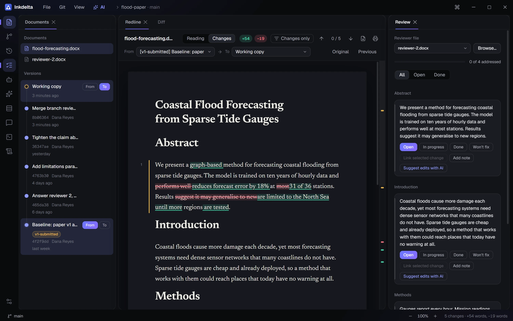
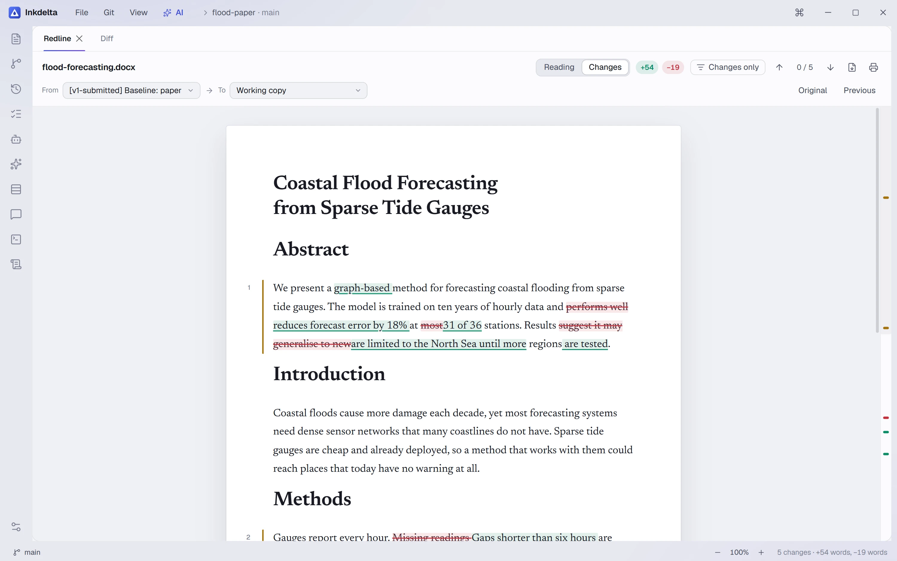
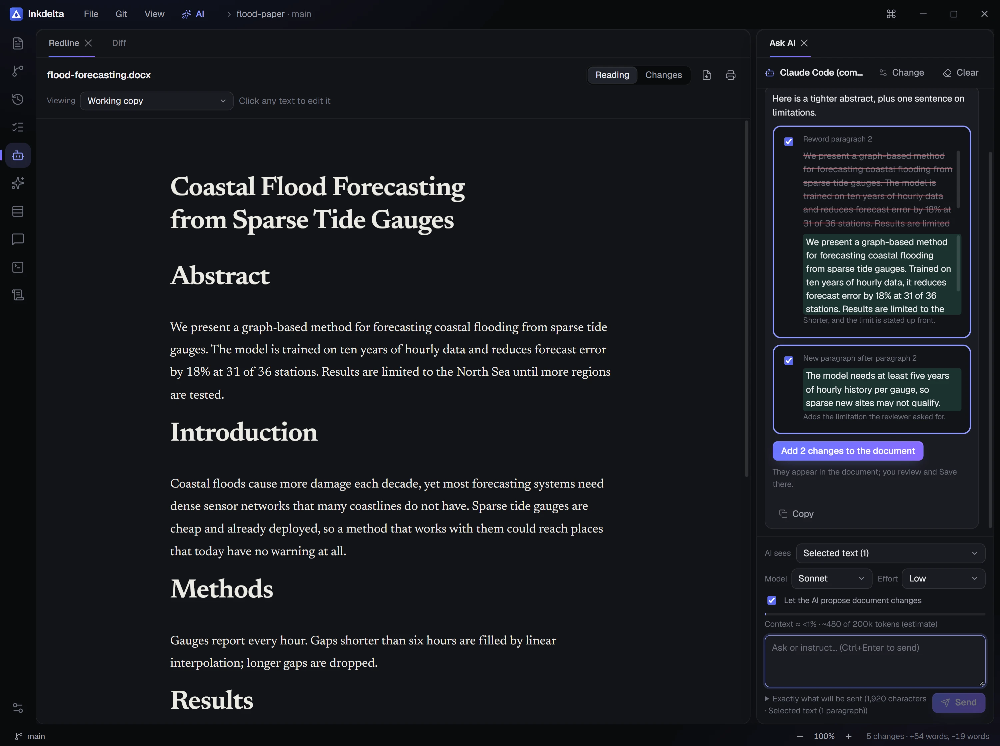
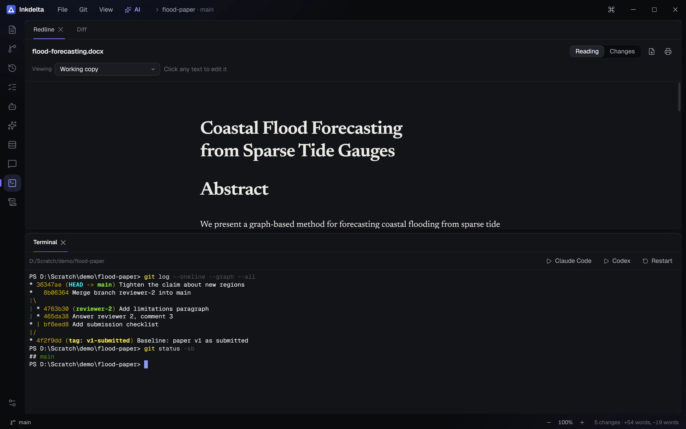
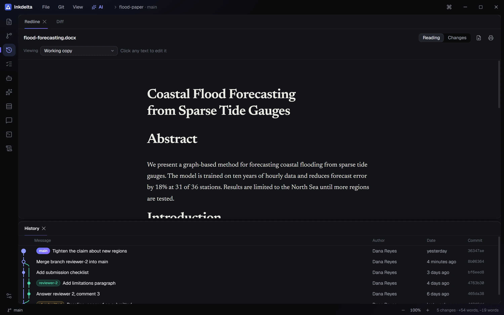

<p align="center"></p>

<h1 align="center">Inkdelta</h1>
<p align="center"><b>See exactly what changed in your Word document.</b></p>
<p align="center"><a href="https://mahir-hs.github.io/inkdelta/">Website</a></p>

<p align="center"></p>

Inkdelta is a desktop app for people who write in Word. It redlines every version of a `.docx` from your Git history,
lets you edit in place, tracks reviewer comments, and has an AI helper and a terminal built in.

## Redline any two versions

Pick any two versions from Git history, a file against its last commit, or two loose files. Paragraphs are lined up first,
then compared word by word, so a reworded sentence shows what moved instead of a struck paragraph. Tables, images and equations
are compared too. The ruler on the right shows where every change sits in the whole paper.



## Edit where you read

Open the working copy and click any text. **Save** writes your changes into the `.docx` and leaves styles, images and equations
alone. **Save & commit** does the Git part too. Paragraphs with equations, tabs or pictures are read-only; edit those in Word.

## Ask an AI, on your terms

You choose what the AI sees (the selection, a section, the whole document, a reviewer comment, or nothing) and can read the exact
message first. Replies can become reworded paragraphs, new paragraphs or removals; you tick the ones you want, then Save.
Works with the command-line tool you already use (Claude Code, Codex), an API key, OpenRouter or Ollama. Model and effort
pickers, a context estimate, and nothing is kept after you close the app.



## A real terminal

A shell in the project folder: run `claude` or `codex` without leaving the window. It keeps running when you switch tabs, and
Git status refreshes when files change.



## A full Git client

Stage, commit and amend; branches, stash and tags; a colour-coded history graph; fetch, pull, push, clone and merge. Pick single
lines to stage, and resolve conflicts section by section. Anything destructive asks first.



Also: a reviewer-comment checklist with notes, VS Code-style docking, eight themes and six accents, zoom, HTML export and print.
Press **Ctrl+K** for every command.

## Run it

Needs Node 22+, pnpm, stable Rust and, on Windows, the Visual Studio C++ build tools. Pull, push and clone also need Git installed.

```
pnpm install
pnpm app                            # run the desktop app
pnpm exec tauri build --no-bundle   # build the program itself
```

Open a project folder with your `.docx` files, or start it on one directly: `inkdelta <folder>`.

## Status

Built and checked on Windows, with real Git: staging, commits, branches, stash, merge conflicts, line staging, comparing
versions, editing and saving into the `.docx`, the Ask AI chat and the terminal.

Not checked yet: the AI with a real provider (the tests used a stand-in tool), pull and push against GitHub, macOS and Linux
(the CI workflow exists but has never run), and installers (only the plain Windows program is built).

The screenshots above use an invented sample paper.

## License

[MIT](LICENSE).

## For developers

[ARCHITECTURE.md](ARCHITECTURE.md) explains the layout and where to change things.

```
cargo test --manifest-path src-tauri/Cargo.toml   # backend tests
pnpm exec tsc --noEmit                            # type-check the UI
```

`.github/workflows/release.yml` builds installers for all three systems when you push a tag like `v0.1.0`; it has never been run.
The website is the `docs/` folder (plain HTML, CSS and JavaScript); `.github/workflows/pages.yml` publishes it.
